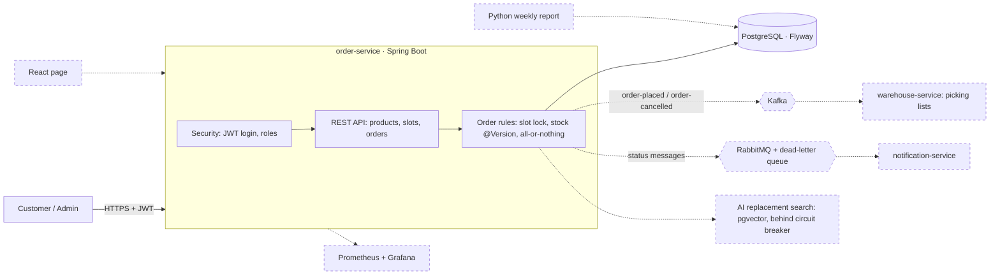
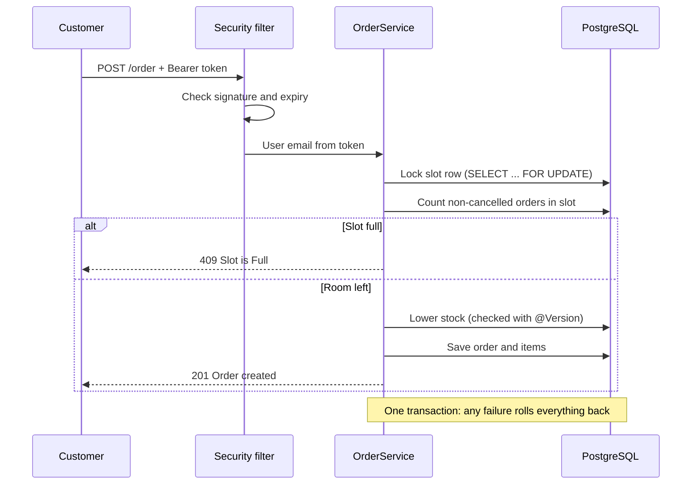

# FreshCart

A grocery-delivery backend in the style of Picnic. Customers browse products, pick a delivery slot and place an order. The system checks stock and slot capacity under concurrent orders, lowers stock, and lets customers cancel before the van leaves.

Work in progress: a learning project, built week by week.

## Architecture

Solid boxes work today. Dashed boxes are planned.

### Placing an order

## What works now

- **Products, delivery slots and orders** through a REST API (`order-service`, Spring Boot, Java 21, PostgreSQL).
- **Slot capacity under load.** The slot row is locked (pessimistic lock) while orders are counted, so a slot is never overbooked. Tested with 10 orders at once on a slot with 5 places: exactly 5 succeed.
- **Correct stock.** Products use optimistic locking (`@Version`), and every order is all-or-nothing (`@Transactional`). If one item is out of stock, nothing in the order is saved.
- **Login with JWT.** Register, log in, get a signed token. Roles: `CUSTOMER` and `ADMIN`; only admins add products. Passwords are hashed with BCrypt.
- **Ownership checks.** Customers only see and cancel their own orders.
- **Schema with Flyway.** Tables change only through migration files; Hibernate only validates.

## Run it

You need Docker and Java 21.

1. Start PostgreSQL: `docker compose up -d`
2. Set an environment variable `JWT_SECRET` to a random Base64 key of at least 32 bytes: `openssl rand -base64 32`
3. Start the app from `order-service`: `./mvnw spring-boot:run`
4. Load test data and run the 8 API checks: `bash api-test.sh`

`api-test.sh` empties the database and loads `data.sql` first. The seeded users are `admin@freshcart.test`, `customer1@freshcart.test` and `customer2@freshcart.test`.

## API

| Method | Path | Who |
|---|---|---|
| POST | `/auth/register` | Anyone |
| POST | `/auth/login` | Anyone, returns a token |
| GET | `/product`, `/product/{id}` | Logged in |
| POST | `/product` | Admin |
| POST | `/order` | Logged in |
| GET | `/order/list`, `/order/{id}` | Owner |
| POST | `/order/{id}/cancel` | Owner, before the slot starts |

Send the token as `Authorization: Bearer <token>`.

## Next

Unit and integration tests (JUnit 5, Mockito, Testcontainers), Docker image and GitHub Actions, then Kafka events to a warehouse service and RabbitMQ notifications.
